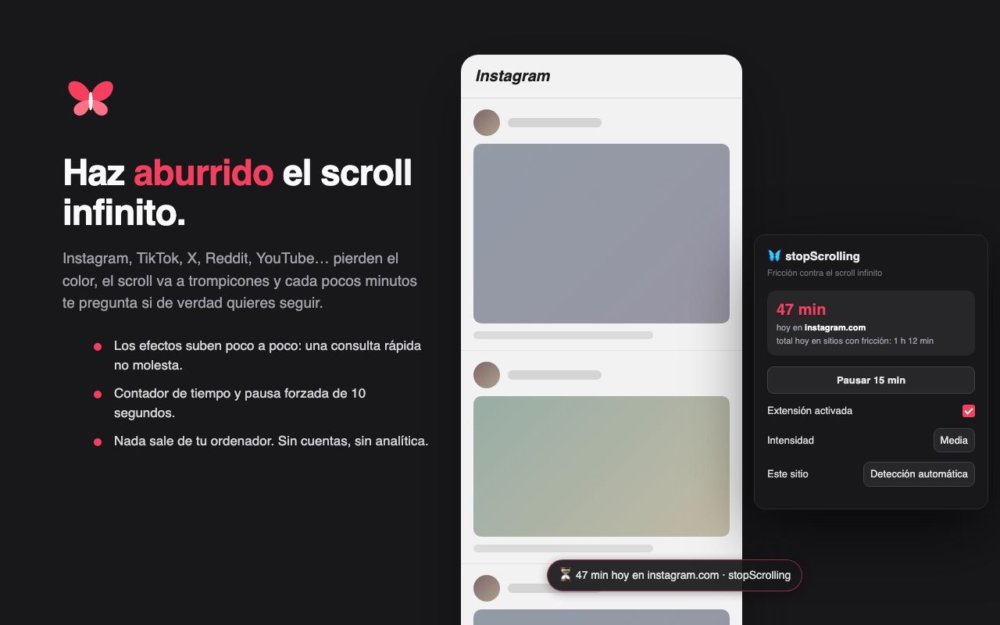
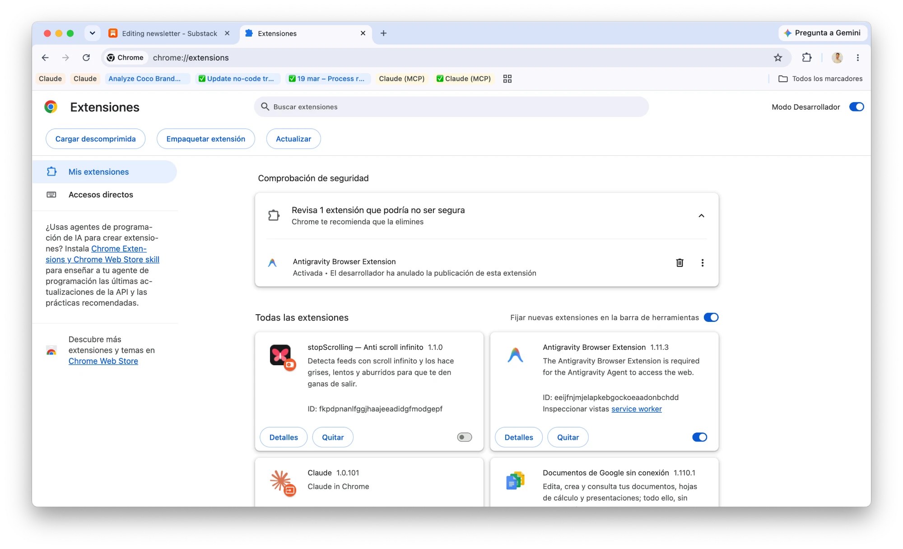
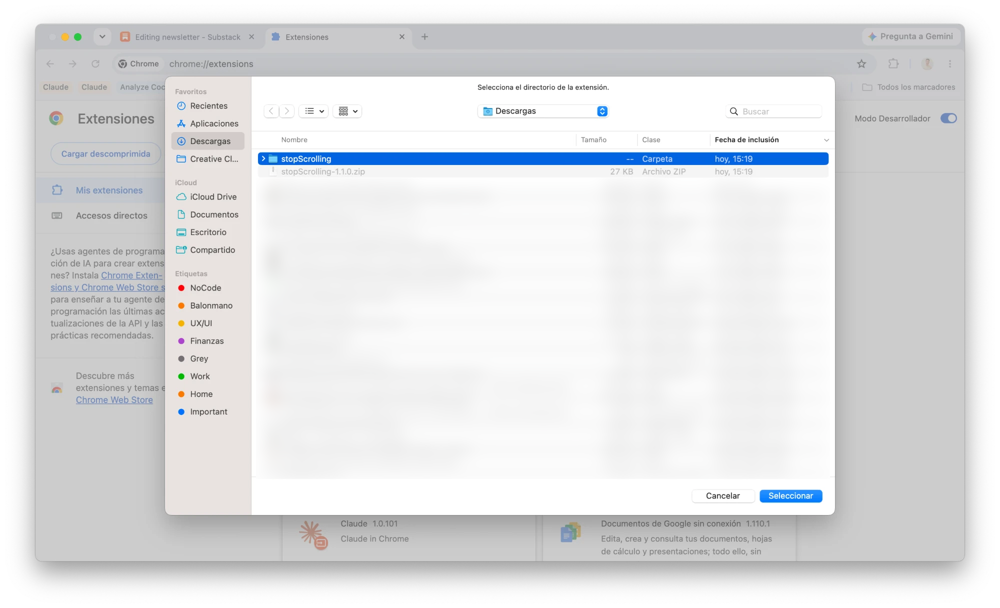
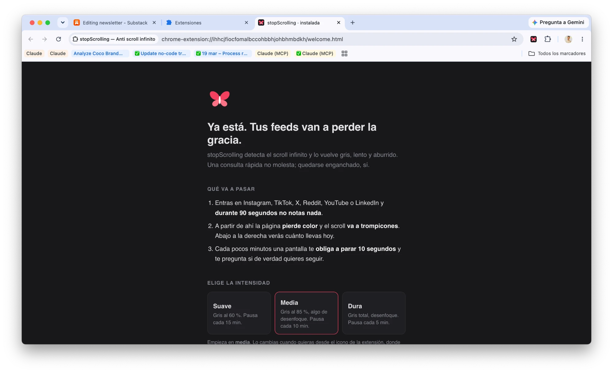

# 🦋 stopScrolling

Extensión de Chrome que detecta páginas con **scroll infinito** (Instagram, TikTok, X, Reddit, YouTube Shorts…) y las hace **grises, lentas y aburridas** — justo lo contrario de lo que esas páginas intentan hacer con tu cerebro.

**[⬇️ Descargar la última versión](https://github.com/ccallelobo/stopScrolling/releases/latest)** · gratis · código abierto · nada sale de tu ordenador

## Instalación

Funciona en Chrome y en los navegadores basados en Chromium (Brave, Edge, Arc).

Dos minutos, cuatro pasos. No hace falta saber programar.

1. **Descarga el ZIP** de la [última release](https://github.com/ccallelobo/stopScrolling/releases/latest) y descomprímelo. Te quedará una carpeta `stopScrolling`. Guárdala en un sitio fijo (por ejemplo, Documentos): Chrome la lee desde ahí, así que no la borres ni la muevas después.
2. **Abre `chrome://extensions`** (cópialo en la barra de direcciones) y activa el **Modo de desarrollador**, el interruptor arriba a la derecha.

   

3. Pulsa **Cargar descomprimida** y elige la carpeta `stopScrolling` que acabas de descomprimir.

   

4. Listo. Se abre una página de bienvenida donde eliges la intensidad. Entra en Instagram o X, espera 90 segundos y observa cómo pierde la gracia 😌

   

Consejo: fija la extensión en la barra (icono de la pieza de puzle, chincheta junto a stopScrolling) para ver de un vistazo cuánto tiempo llevas.

> Chrome puede recordarte de vez en cuando que tienes extensiones en modo desarrollador. Es normal: la extensión no está en la Chrome Web Store.

## Licencia

MIT. Úsala, cámbiala, hazla tuya.

## Qué hace cuando detecta un feed infinito

| Fricción | Descripción |
|---|---|
| 🎨 Escala de grises | La página pierde el color y el contraste progresivamente (en ~90 s) |
| 🐌 Scroll a trompicones | El scroll con rueda, trackpad y teclado se vuelve lento e irregular |
| 💤 Carga desganada | El contenido nuevo del feed aparece con un fundido lento |
| ⏳ Contador de tiempo | Una píldora abajo a la derecha te recuerda cuánto llevas hoy en ese sitio |
| 🛑 Pausa forzada | Cada X minutos, una pantalla te obliga a parar 10 segundos y te pregunta si de verdad quieres seguir |

Los efectos **suben gradualmente durante los primeros 90 segundos**: una consulta rápida no molesta; quedarse enganchado, sí.

## Cómo detecta el scroll infinito

- **Lista de sitios conocidos**: Instagram, TikTok, Facebook, X/Twitter, Reddit, Pinterest, Twitch, 9GAG, Tumblr, Threads, Bluesky, el feed de LinkedIn y YouTube (portada, Shorts, feeds y búsqueda — ver un vídeo concreto no activa la fricción).
- **Heurística genérica**: en cualquier otra web, si al acercarte al final la página "crece" varias veces (señal inequívoca de feed infinito), se activa la fricción automáticamente.

## Configuración (icono de la extensión)

- **Pausar 15 min**: quita la fricción un rato y la reactiva sola. Así no hace falta desactivar la extensión (y olvidarse de volver a activarla).
- **Intensidad**: suave / media / dura (cambia el gris, la lentitud del scroll y la frecuencia de las pausas: cada 15 / 10 / 5 minutos).
- **Por sitio**: detección automática, "siempre con fricción" o "nunca" (lista blanca para sitios de trabajo). Si eliges "siempre" en una web que no está en la lista, Chrome pedirá permiso solo para esa web.
- **Detectar feeds en cualquier web**: activa la heurística genérica fuera de la lista de redes conocidas. Chrome pedirá permiso para todas las webs; sin esto la extensión solo actúa en las redes de la lista.
- **Estadísticas**: tiempo de hoy en el sitio actual y total en sitios con fricción.

## Permisos

Por defecto la extensión **solo se inyecta en las redes de la lista** (Instagram, TikTok, X, Reddit, YouTube, LinkedIn…). No lee ni toca el resto de tu navegación. Los permisos para otras webs son opcionales y se piden solo cuando tú activas una opción que los necesita.

## Dónde no actúa aunque estés en una red

En las zonas de conversación de cada red (mensajes directos, bandeja de mensajes, ajustes, un hilo concreto de Reddit) la fricción se desactiva sola: ahí no hay scroll infinito que combatir. Tampoco frena el zoom (Ctrl + rueda), el scroll horizontal de los carruseles ni el scroll dentro de un campo de texto. La pausa forzada espera a que termines de escribir si tienes un campo de texto activo.

## Limitaciones conocidas

- Solo funciona en Chrome de escritorio (y navegadores basados en Chromium: Brave, Edge, Arc…).
- Si tienes el mismo feed abierto en dos pestañas visibles a la vez, el tiempo puede contarse doble.
- Las estadísticas se guardan solo en tu navegador (14 días) y no salen de tu máquina.
